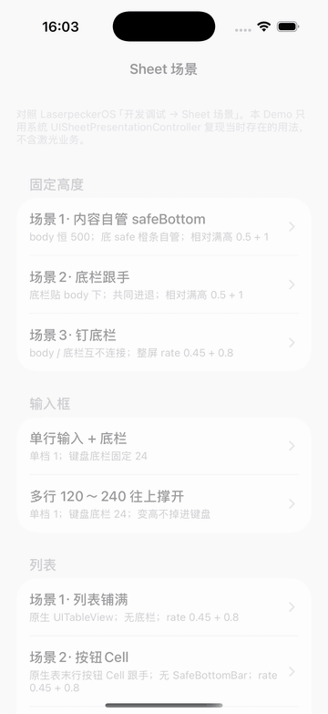

# PanSheet

独立的 **UIKit + Swift** 半屏演示 App。从 LaserpeckerOS「我的 → 开发调试 → Sheet 场景」抽出当时真实存在的用法，去掉激光业务，用系统 `UISheetPresentationController`（iOS 16+ 自定义 detent）对照实现。

源工程只读，本仓库不依赖 LaserpeckerOS。

## 预览

循环总览：首页列表依次打开 8 个半屏再关掉（iPhone 17 Pro 模拟器，约 20 秒）。只放这一张小尺寸 GIF，GitHub 预览不会竖着撑很高。

<p align="center">
  
</p>

## 怎么跑

1. 安装 Xcode 16+（本机验证用 Xcode 26 / iOS 26 模拟器）。
2. 打开 `PanSheet.xcodeproj`，选一台 **iPhone** 模拟器。
3. 运行 `PanSheet`。首页就是源页「Sheet 场景」的入口列表。
4. 点某一行，弹出对应半屏。拖抓手换档、点遮罩或右上勾 /「确定」关闭。

命令行（把 `id=` 换成 `xcrun simctl list devices available` 里已启动的模拟器）：

```bash
cd /Users/feixiang/Desktop/hwq/PanSheet
xcodegen generate
xcodebuild -project PanSheet.xcodeproj -scheme PanSheet \
  -destination 'platform=iOS Simulator,id=<SIM_UDID>' \
  -derivedDataPath build/DerivedData \
  CODE_SIGNING_ALLOWED=NO build
xcrun simctl install <SIM_UDID> \
  build/DerivedData/Build/Products/Debug-iphonesimulator/PanSheet.app
xcrun simctl launch <SIM_UDID> com.hwq.PanSheet
```

截图 / 录 GIF：

```bash
./scripts/capture-screenshots.sh   # 静态九宫格用的单帧
./scripts/capture-tour-gif.sh      # 模拟器录 8 个场景打开过程 → Docs/screenshots/tour.gif
```

`--tour` 会按列表顺序带动画打开再关掉这 8 个半屏，给录制用。

## 何时用哪种 Sheet

都是 **四号半屏**（挡背后、点外可关、可下拉关）。源引擎是 `XWonderSheet`；这里用系统 page sheet + 自定义 detent 表达同一套档位。

固定高度场景 1 / 2 默认停在相对满高 **0.5**，上拖到 1 才能看到橙垫或跟手底栏（低档时从底部裁切，与源「表面 < preferred 则 content 向下溢出」一致）。场景 3 与列表默认停在整屏 **0.45**，底栏（若有）钉在半屏底。

| 分组 | 场景 | 何时用 | 档位 |
| --- | --- | --- | --- |
| 固定高度 | 场景1·内容自管 safeBottom | 内容有固定 body，Home 指示条由内容自己垫橙条，不要把 safeBottom 算进 body | 相对内容满高 **0.5 + 1**，默认停 0.5 |
| 固定高度 | 场景2·底栏跟手 | 底栏贴在 body 下面，拖高时和 body **一起走**，余高留给壳白底 | 同上 |
| 固定高度 | 场景3·钉底栏 | 底栏钉在半屏底不动，变高只拉 body 与底栏之间的空隙 | 整屏 **0.45 + 0.8**，默认 0.45 |
| 输入框 | 单行输入 + 底栏 | 单行字段 + 确定条；键盘起来时底栏间距改 12，半屏跟着抬 | **单档满高** |
| 输入框 | 多行 120～240 往上撑开 | 多行输入随文本 120～240 往上长，底栏钉底不往键盘里掉 | **单档满高** |
| 列表 | 场景1·列表铺满 | 只有表，没有底栏；表铺满顶栏以下，底 inset = Home | 整屏 **0.45 + 0.8** |
| 列表 | 场景2·按钮Cell | 确定按钮是表的最后一行，跟着列表滚 | 整屏 **0.45 + 0.8** |
| 列表 | 场景3·钉底栏 | 表底对齐底栏顶；底栏自带 safeBottom，表 inset = 0 | 整屏 **0.45 + 0.8** |

不要把场景 2（跟手）和场景 3（钉底）混用：2 是 `底栏.top = body.bottom`；3 是 `底栏.bottom = 父底`，中间另留 gap / 表。

## 关键 API

| 能力 | 本 Demo | LaserpeckerOS 源 |
| --- | --- | --- |
| 弹出 | `PanSheetPresenter.present` → `modalPresentationStyle = .pageSheet` | `XWonderSheetViewController.present(from:)` |
| 档位 | `UISheetPresentationController.Detent.custom`（iOS 16） | `XWonderSnap.fixed` / `.rate` |
| 抓手 | `prefersGrabberVisible = true` | 壳 + `LPSheetNavBar` 拖动手把 |
| 列表跟手扩档 | `prefersScrollingExpandsWhenScrolledToEdge` | `trackedScrollView` 嵌套滚动 |
| 顶栏 | `PanSheetNavBar`（56、白底、勾确认） | `LPSheetNavBar` |
| 底栏 | `PanSheetSafeBottomBar`（顶 12、底 `max(24, safeBottom)`，键盘时 12） | `LPSafeBottomBar` |
| 键盘 | `keyboardWillChangeFrame` 改 detent + `isKeyboardLifted` | `liftsWithKeyboard` / `bottomOffset` |

内容定高换算（场景 1 / 2）与源 `DebugSheetScenarioContentRelativeSnaps.fixedSnaps(rates: [0.5, 1])` 一致：表面高 = panel × rate。列表 / 钉底栏用整屏比例，不要按 panel 再换 0.5/1。

## 和 LaserpeckerOS 场景的对应

源入口：`apps/ios/core/ui/Sources/LPCoreUI/Debug/Sheet/Scenarios/DebugSheetScenariosViewController.swift`  
规范：`docs/界面规范/Sheet场景.md`

| 本 Demo | 源 content VC | 源入口 id |
| --- | --- | --- |
| `HomeListViewController` | `DebugSheetScenariosViewController` | `debug-sheet-scenarios` |
| `FixedHeightManagedSafeBottomViewController` | `DebugSheetScenario1FixedHeightContentViewController` | `debug-sheet-scenario-1-content-managed` |
| `FixedHeightBottomBarFollowViewController` | `DebugSheetScenario2BottomBarFollowContentViewController` | `debug-sheet-scenario-2-bottom-bar` |
| `FixedHeightPinnedBarViewController` | `DebugSheetScenario3PinnedBarContentViewController` | `debug-sheet-scenario-3-pinned-bar` |
| `InputSingleLineViewController` | `DebugSheetScenario1InputSingleLineContentViewController` | `debug-sheet-scenario-input-single` |
| `InputMultilineViewController` | `DebugSheetScenario2InputMultilineContentViewController` | `debug-sheet-scenario-input-multi` |
| `ListFillViewController` | `DebugSheetScenario1ListFillContentViewController` | `debug-sheet-scenario-list-fill` |
| `ListButtonCellViewController` | `DebugSheetScenario2ListButtonCellContentViewController` | `debug-sheet-scenario-list-scroll-bar` |
| `ListPinnedBarViewController` | `DebugSheetScenario3ListPinnedBarContentViewController` | `debug-sheet-scenario-list-pinned` |

源页里没有的用法（一号 / 二号 ActionSheet / 五号穿透 / 嵌套二次 present 等）**没有**做进本 Demo。

静态九宫格单帧：`Docs/screenshots/grid-3x3.png`。

## 工程结构

```text
App/          入口、首页列表、场景枚举
Demos/        每种用法一个 ViewController，外加半屏壳 / 顶栏 / 底栏
Docs/screenshots/   含 tour.gif 总览与静态九宫格
scripts/capture-screenshots.sh
scripts/capture-tour-gif.sh
```
