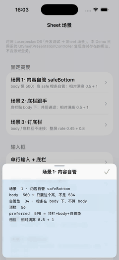
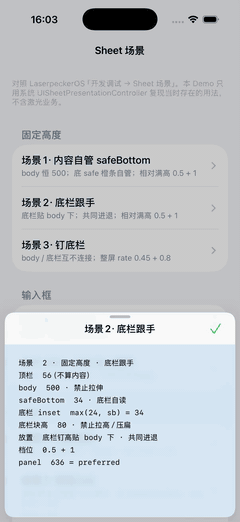
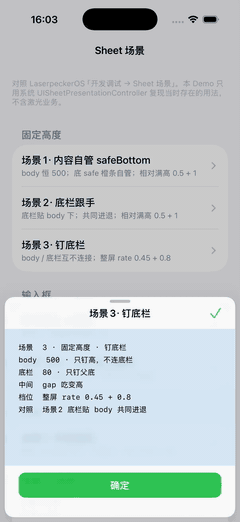
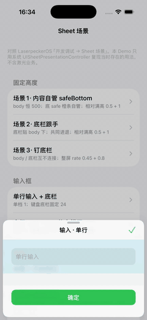
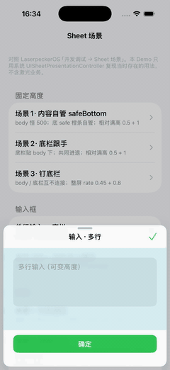
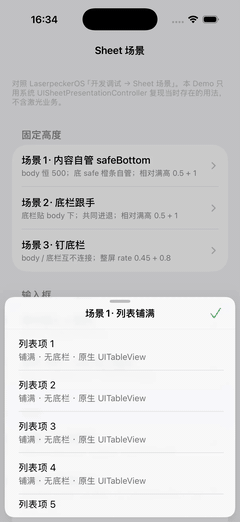
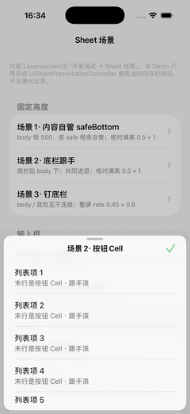
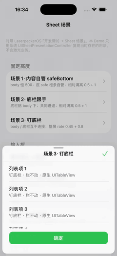

# PanSheet

iOS 16+ **纯 UIKit** 半屏库（Swift Package）。从 LaserpeckerOS「我的 → 开发调试 → Sheet 场景」抽出当时真实存在的 8 种用法，用系统 `UISheetPresentationController` 自定义 detent 实现。不含激光业务，也不依赖 CocoaPods。

仓库里的 Demo App 只演示这 8 种场景，半屏实现全部走本 Package。

## 集成

最低 **iOS 16**。Xcode：File → Add Package Dependencies…，填下面任一地址。

**GitHub**

```text
https://github.com/hwq992689548/PanSheet
```

Dependency Rule 选 Branch `main`，或 Version：Up to Next Major from `1.0.0`。

**本地路径（选含 `Package.swift` 的仓库根，不要选 xcodeproj）**

```text
/Users/你/path/PanSheet
```

Xcode：Add Package Dependencies → Add Local… → 选这个根目录。产品名是 **PanSheet**。

Swift Package 清单：

```swift
dependencies: [
    .package(url: "https://github.com/hwq992689548/PanSheet.git", from: "1.0.0"),
    // 或本地：
    // .package(path: "../PanSheet"),
]
```

然后在 target 里加 `PanSheet`。

### 最小调用

自己准备内容页，用配置对象弹出。`followsScrolling` 默认打开：贴顶的 `UITableView` 滚到边界时，半屏跟手上移 / 下移。

```swift
import PanSheet
import UIKit

final class HostViewController: UIViewController {
    func openListSheet() {
        let content = MyListViewController()
        PanSheetPresenter.present(
            from: self,
            config: .listFill(content: content)
        )
    }
}
```

8 种场景工厂：

```swift
PanSheetPresenter.present(from: self, config: .fixedManagedSafeBottom(content: vc))
PanSheetPresenter.present(from: self, config: .fixedBottomBarFollow(content: vc))
PanSheetPresenter.present(from: self, config: .fixedPinnedBar(content: vc))
PanSheetPresenter.present(from: self, config: .inputSingleLine(content: vc))
PanSheetPresenter.present(from: self, config: .inputMultiline(content: vc))
PanSheetPresenter.present(from: self, config: .listFill(content: vc))
PanSheetPresenter.present(from: self, config: .listButtonCell(content: vc))
PanSheetPresenter.present(from: self, config: .listPinnedBar(content: vc))
```

自定义档：

```swift
var config = PanSheetConfig(
    content: content,
    layout: .custom([
        .fraction(0.45, id: "low"),
        .fraction(0.80, id: "high"),
    ]),
    followsScrolling: true
)
PanSheetPresenter.present(from: self, config: config)
```

键盘或正文变高时改输入档：

```swift
PanSheetPresenter.updateInputDetent(on: content, panelHeight: newHeight)
PanSheetPresenter.dismiss(from: content)
```

顶栏 / 底栏也可直接用：`installNavBar(title:)`、`PanSheetSafeBottomBar`。

## 预览

半屏弹出之后，在内容上滑：sheet 跟手上移；再下滑：sheet 跟手下移（列表场景是表内滚动联动，其它场景拖抓手换档）。8 条小 GIF，四列两行。

<table>
  <tr>
    <td align="center" width="25%"><br/>场景1·内容自管</td>
    <td align="center" width="25%"><br/>场景2·底栏跟手</td>
    <td align="center" width="25%"><br/>场景3·钉底栏</td>
    <td align="center" width="25%"><br/>单行输入</td>
  </tr>
  <tr>
    <td align="center" width="25%"><br/>多行输入</td>
    <td align="center" width="25%"><br/>列表铺满</td>
    <td align="center" width="25%"><br/>按钮 Cell</td>
    <td align="center" width="25%"><br/>列表钉底栏</td>
  </tr>
</table>

## 怎么跑 Demo

1. 安装 Xcode 16+（本机验证用 Xcode 26 / iOS 26 模拟器）。
2. 用 Xcode 打开 **`PanSheet.xcworkspace`**（不要打开仓库根上已删除的 `PanSheet.xcodeproj`：它和 `Package.swift` 同级，会报 Missing package product）。
3. 选 scheme **PanSheetDemo**，iPhone 模拟器。也可以只打开 `Demo/PanSheet.xcodeproj`，它用本地包路径 `..`。
4. 运行。首页就是源页「Sheet 场景」的入口列表。点某一行弹出对应半屏。

重新生成 Demo 工程：

```bash
./scripts/generate-demo.sh
```

```bash
cd /path/to/PanSheet
xcodebuild -workspace PanSheet.xcworkspace -scheme PanSheetDemo \
  -destination 'platform=iOS Simulator,id=<SIM_UDID>' \
  -derivedDataPath build/DerivedData \
  CODE_SIGNING_ALLOWED=NO build
xcrun simctl install <SIM_UDID> \
  build/DerivedData/Build/Products/Debug-iphonesimulator/PanSheet.app
xcrun simctl launch <SIM_UDID> com.hwq.PanSheet
```

截图 / 录跟手 GIF：

```bash
./scripts/capture-screenshots.sh    # 静态单帧
./scripts/capture-scroll-gifs.sh    # 弹出后滚列表 / 拖抓手，8 条 *-scroll.gif
```

`--hold-sheet` 录制时禁止滑关掉，只在档位之间跟手。

## 何时用哪种 Sheet

都是 **四号半屏**（挡背后、点外可关、可下拉关）。源引擎是 `XWonderSheet`；这里用系统 page sheet + 自定义 detent 表达同一套档位。

固定高度场景 1 / 2 默认停在相对满高 **0.5**，上拖到 1 才能看到橙垫或跟手底栏。场景 3 与列表默认停在整屏 **0.45**，底栏（若有）钉在半屏底。

| 分组 | 场景 | 配置工厂 | 档位 |
| --- | --- | --- | --- |
| 固定高度 | 场景1·内容自管 safeBottom | `.fixedManagedSafeBottom` | 相对内容满高 **0.5 + 1** |
| 固定高度 | 场景2·底栏跟手 | `.fixedBottomBarFollow` | 同上 |
| 固定高度 | 场景3·钉底栏 | `.fixedPinnedBar` | 整屏 **0.45 + 0.8** |
| 输入框 | 单行输入 + 底栏 | `.inputSingleLine` | **单档满高** |
| 输入框 | 多行 120～240 往上撑开 | `.inputMultiline` | **单档满高** |
| 列表 | 场景1·列表铺满 | `.listFill` | 整屏 **0.45 + 0.8** |
| 列表 | 场景2·按钮Cell | `.listButtonCell` | 整屏 **0.45 + 0.8** |
| 列表 | 场景3·钉底栏 | `.listPinnedBar` | 整屏 **0.45 + 0.8** |

不要把场景 2（跟手）和场景 3（钉底）混用：2 是 `底栏.top = body.bottom`；3 是 `底栏.bottom = 父底`，中间另留 gap / 表。

## 公开 API

| 能力 | API |
| --- | --- |
| 弹出 | `PanSheetPresenter.present(from:config:)` |
| 配置 | `PanSheetConfig` + 上表 8 个工厂；`layout` / `followsScrolling` |
| 档位 | `PanSheetLayout`、`PanSheetDetent.height` / `.fraction` |
| 关闭 | `PanSheetPresenter.dismiss(from:)` |
| 输入改高 | `PanSheetPresenter.updateInputDetent(on:panelHeight:)` |
| 列表跟手 | `config.followsScrolling` → `prefersScrollingExpandsWhenScrolledToEdge` |
| 顶栏 | `installNavBar(title:)` / `PanSheetNavBar` |
| 底栏 | `PanSheetSafeBottomBar` |
| 常量 | `PanSheetMetrics`、`PanSheetPalette`、`PanSheetContentRelativeSnaps` |

源页里没有的用法（一号 / 二号 ActionSheet / 五号穿透 / 嵌套二次 present 等）没有做进本库。

## 工程结构

```text
Package.swift                 Swift Package（产品名 PanSheet，给别的工程 Add Package）
Sources/PanSheet/             可复用 UIKit
PanSheet.xcworkspace          打开这个：含本地包 + Demo
Demo/PanSheet.xcodeproj       Demo App，本地 SPM 引用 path: ..
Demo/App + Demo/Demos         场景页
Docs/screenshots/
scripts/generate-demo.sh
```
